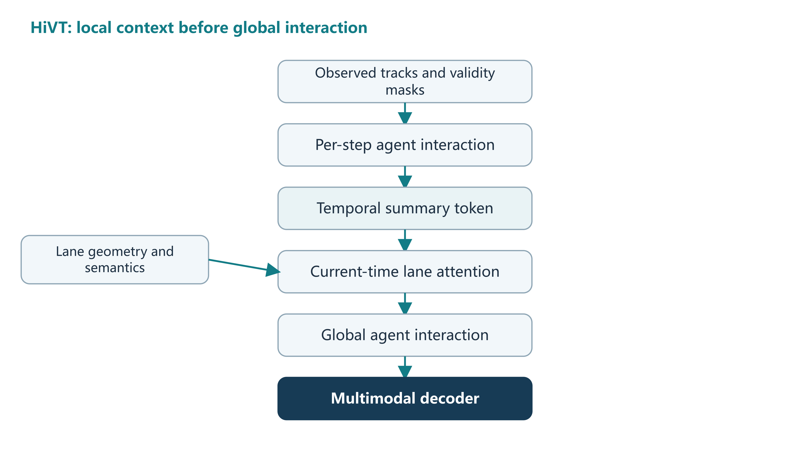
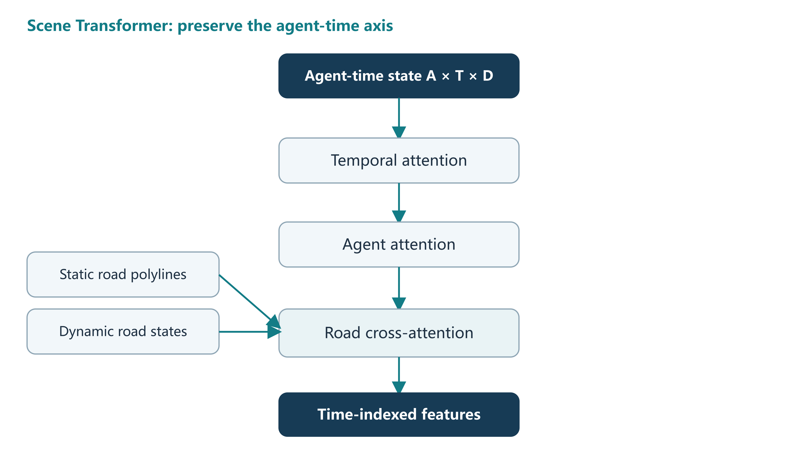

## Information flow and the timing of compression in HiVT and Scene Transformer

A vehicle approaches a highway from an on-ramp while a car on the mainline closes in and the available gap changes. The inputs may consist only of short trajectory histories, agent attributes, and map polylines. The downstream predictor or planner, however, needs a representation that preserves who may affect whom, when that relation changed, and which motions the road permits.

This article asks a testable architectural question: **when does compressing history remove information needed by later cross-agent interaction?** HiVT first builds agent-centered local representations, summarizes each agent's history, and then performs global interaction. Scene Transformer keeps an agent-by-time tensor through deeper layers. I trace both information paths, distinguish what the papers establish from engineering inferences, and propose controlled tests for choosing between them.

## 1. The encoder's input and output contract

Let A be the number of dynamic agents, T the number of observed time steps, L the number of map elements, and D the hidden dimension. The inputs are an ordered agent history X = {x_(a,t)} and a map set M = {m_l}. An agent state may include displacement, speed, heading, class, and a validity mask. A map element may describe a lane segment, boundary, stop line, intersection, or traffic signal. Exact fields vary by dataset, but time remains ordered, agent count varies, and the map contains geometric and sometimes topological relations.

The encoder may return one summary vector per agent, H_agent in R^(A x D), or a representation indexed by both agent and time, H_scene in R^(A x T x D). Both can encode history and interaction. Their difference is the interface left for later modules: the first requires those modules to read history through a fixed-length summary, whereas the second permits access to time-indexed features. The central comparison is therefore when time is summarized and whether cross-agent information is exchanged before or after that step.

## 2. HiVT: agent-centered hierarchical encoding

HiVT divides a scene into local regions centered on individual agents. For each focal agent, it builds a local representation from nearby agents and lanes. A subsequent global module passes messages among the resulting agent vectors. The paper calls these stages *local context extraction* and *global interaction modeling*.

The local stage has a definite order. First, agent-agent interaction is computed separately at each observed time step. Second, a temporal Transformer reads the resulting sequence and updates an appended learnable summary token. Third, at the current time, that token queries lane segments through agent-lane attention. Only after these steps does global agent interaction occur. Prediction modes are expanded by the decoder; the local encoder is not rerun for every mode.

For consistency with Scene Transformer, I write A for the agent count that the HiVT paper denotes by N. The focal agent's orientation is estimated from its final displacement. The same rotation R_i is used for all its historical time steps. Geometric vectors are multiplied by R_i transposed so they are expressed in the focal agent's heading frame.

### 2.1 Spatial interaction at each time step

At time t, a focal agent i attends to neighbors j inside a local radius. The focal embedding uses its displacement and attributes. Each neighbor embedding also includes the agent-agent relative position:

z_(i,t) = phi_center(R_i^T (p_(i,t) - p_(i,t-1)), a_i)

z_(ij,t) = phi_nbr(R_i^T (p_(j,t) - p_(j,t-1)), R_i^T (p_(j,t) - p_(i,t)), a_j)

The relative position is part of the neighbor embedding, rather than an unrelated feature appended after attention. The center supplies the query, and neighbors supply keys and values. Attention is normalized over the neighbor set. HiVT then uses a gate to mix the center representation with the aggregated environmental message, followed by an MLP, LayerNorm, and residual connections. If an agent is invisible at a time step, geometry is first zero-filled and then replaced by a learnable padding token before temporal modeling.

### 2.2 Temporal compression with a summary token

The spatial embeddings for one agent are placed in time order, with a learnable token appended. After positional encoding, temporal attention uses a causal mask: a position may attend to itself and earlier positions, but not later ones. The updated appended token is passed to the lane module. It is neither a simple mean of historical embeddings nor an unchanged copy of the last frame. From this point onward, downstream modules retrieve that agent's history through the summary token rather than through individual time-indexed features.

### 2.3 Current-time agent-lane interaction

At the current time T, the summary token queries nearby lane segments. A lane embedding combines its direction, its position relative to the focal agent, and semantic attributes:

u_(i,xi) = phi_lane(R_i^T (p_(xi,1) - p_(xi,0)), R_i^T (p_(xi,0) - p_(i,T)), a_xi)

The first geometric term is the lane segment's direction; the second is the lane start point relative to agent i. Both use the same focal frame. The lane MLP output supplies the attention keys and values. Attention and gating follow the pattern used for agent-agent interaction, after which an MLP produces the local agent embedding.

### 2.4 Global interaction and modal decoding

The global module passes information between agent vectors using current-time relative position and heading difference. Its pairwise relation includes R_i^T (p_(j,T) - p_(i,T)), cos(theta_j - theta_i), and sin(theta_j - theta_i). Unlike the earlier local agent-agent stage, this pairwise embedding is concatenated with the neighbor vector for the global attention keys and values. The dense global relation has O(A^2) pairwise scale.

The decoder receives local and global vectors. Each mode-specific head predicts future positions and Laplace scales in the agent's local frame; another head predicts mixture weights. The reported regression tensor has shape [F, A, H, 4], where F is the number of modes, H the prediction horizon, and the final dimension covers two position coordinates and their scales. The local and global encoders do not repeat for each mode.

Translation invariance follows from displacements and relative positions. Rotating vectors into each focal agent's heading frame provides the corresponding rotational treatment. Position differences alone remove translation, not rotation. Local-frame trajectory outputs must be rotated and translated back before comparison in scene coordinates.

*Figure 1. HiVT information flow. Per-time-step agent interaction precedes temporal summarization; current-time lane attention and global interaction follow it. Batch dimensions, gates, and attention heads are omitted.*

## 3. Scene Transformer: keeping a spatiotemporal tensor

Scene Transformer uses a scene-centered coordinate frame and maintains an agent-time tensor with shape [A, T, D] through its encoder. Static road polylines are summarized with PointNet. Elements whose location is static but state changes over time, such as traffic lights, receive a separate dynamic-road representation. Positions are transformed relative to a common scene reference and receive sinusoidal position encodings. HiVT also transforms coordinates, but it uses the heading frame of each focal agent for spatial relations instead of one frame shared by the scene.

### 3.1 Alternating attention over time and agents

Flattening all A x T tokens into one dense self-attention operation would produce a score matrix of quadratic size in AT. Scene Transformer factorizes the exchange: a temporal layer fixes the agent and attends over its time steps; an agent layer fixes the time and attends over agents. These layers alternate. Each remains a standard Transformer block with feed-forward processing, residual connections, and normalization. Their outputs communicate across axes over successive layers; they are not two isolated models.

The time axis also helps maintain identity. All time steps belonging to one agent stay on the same axis without a separate agent identifier. Under identical masking patterns, a fully pooled set of masked tokens could otherwise become indistinguishable. Factorization thus provides both computational savings and an inductive bias about temporal identity.

### 3.2 Road information through cross-attention

Road elements are not simply appended to the agent-time sequence. Agent features provide queries; road embeddings provide keys and values. Static polyline embeddings remain fixed after PointNet and are reused across time, while dynamic-road embeddings can vary by time. The cross-attention output updates agents, not the road embeddings. In the paper's layer specification this operation is performed per time step, with an attention score tensor indexed by time, agent, and road element.

The mathematical operation is the standard scaled attention: apply softmax to the scaled QK-transposed scores, then multiply by V. Invalid agent or road tokens require a separate mask with compatible dimensions. The road embedding, the visibility mask, and HiVT's temporal causal mask serve different purposes and should not be conflated.

### 3.3 Visibility masks define the prediction task

Scene Transformer's time axis can include future steps to be completed. Visibility masks specify the task: marginal prediction exposes observed history and masks future states; conditional marginal prediction additionally exposes the ego vehicle's full future trajectory in the paper's setup; goal-conditioned prediction exposes an ego goal state. The encoder retains [A, T, D], while multiple joint futures enter during decoding. Axial attention alone does not create conditional prediction. The conditioning information must be exposed by the task mask and supported by training losses.

*Figure 2. Scene Transformer information flow. Agent-time features alternate attention over the two axes and query road embeddings through cross-attention. The diagram shows dependencies, not the exact repeated layer schedule.*

## 4. What the two encoding paths actually trade

| Dimension | HiVT | Scene Transformer |
|---|---|---|
| Reference frame | Spatial messages use each focal agent's heading frame | Agents share a scene reference frame |
| Intermediate state | One vector per agent after local temporal summarization | An agent-by-time tensor persists through the backbone |
| Cross-agent exchange | Per-time-step local exchange, then global exchange over summaries | Agent and temporal attention alternate across layers |
| Road fusion | Agent-lane attention after temporal summarization | Agent features query fixed road embeddings at each time step |
| Multimodal interface | Modes expand in the decoder | Multiple futures enter at decoding |
| Main inductive bias | Local neighborhoods, hierarchy, geometric normalization | Shared scene state, axial propagation, mask-based completion |

The most useful dividing line is whether a later cross-agent module can still access a specific time index. HiVT must first encode a brief braking event or a change in yielding order into an agent summary. Scene Transformer leaves a direct time-indexed path at deeper layers. HiVT is not merely a local graph: it has a later global module. Scene Transformer is not one flat attention operation over every token: it propagates information through separate axes and road cross-attention.

## 5. Complexity is not automatically linear

Dense self-attention over agent-time tokens has O((AT)^2) score scale. A temporal layer in Scene Transformer costs O(AT^2), an agent layer O(TA^2), and per-time-step road cross-attention adds roughly O(TAG) for G road embeddings. Factorization removes the A^2T^2 term but each axis still contains a quadratic component.

HiVT describes local encoding with terms corresponding to temporal attention, per-time-step local agent interaction, and agent-lane interaction. If local neighborhoods are bounded by k agents and ell lane segments, these terms can be written O(AT^2 + TAk + A ell), with a separate O(A^2) global interaction term. Actual runtime also depends on graph construction, sparse aggregation, memory traffic, padding, hidden width, precision, and hardware. Neither fewer edges nor a more regular tensor alone establishes lower end-to-end latency.

## 6. Tests that can isolate encoder behavior

The papers report motion-prediction results, but final metrics also depend on input processing, decoder, losses, augmentation, and training budget. Scene Transformer reports a minADE of 0.609 for its factorized configuration versus 0.639 for its non-factorized configuration in its own experiment. That supports the complete configuration under those conditions; it does not isolate every architectural component or justify cross-paper ranking.

**Information reachability.** Construct scenes with sustained closing speed, brief braking, and reappearance after occlusion. Test sensitivity to event order. Vary a local radius or remove an intermediary agent to check whether distant information follows the intended path. A graph path existing is different from a trained model using it.

**Map dependence.** Keep agent histories fixed while changing merge topology, lane direction, or signal state. Compare encoded features and predictions. Remove geometry and semantics separately to detect reliance on one unstable field.

**Geometric consistency.** Apply the same rigid translation or rotation to a scene, transform predicted trajectories back, and compare. Features may be designed to be invariant; trajectories in scene coordinates should be equivariant: f(gX) = g f(X). HiVT local-frame outputs must be returned to the scene frame before this test.

**Missing-data robustness.** Remove selected history frames, agents, or map elements. Verify that padding masks block invalid tokens and that empty neighborhoods remain well-defined. Scene Transformer needs separate treatment of task masks and missing-data masks; HiVT needs checks for missing neighbors, first trajectory steps, and absent valid lanes.

**Controlled ablations and deployment cost.** Change temporal summarization, local or global interaction, and road cross-attention one at a time while holding training and decoding constant. Record accuracy in critical interaction slices, end-to-end P95/P99 latency, and peak memory on target hardware. Attention weights can aid debugging but cannot alone establish causality.

## 7. Choosing a representation by the information bottleneck

First ask whether each agent's motion summary is sufficient for the downstream task. If it is, HiVT's hierarchical compression can reduce the need to carry a full time axis. If decisions depend on the order of specific multi-agent events, compare a representation that keeps time-indexed features deeper into the network. A longer history is not, by itself, proof that later temporal access is necessary: larger summaries or better temporal encoders may solve the same problem.

Next ask whether stable geometric relations favor explicit local edges or whether a direct scene-wide time path is more useful. Distance alone is an incomplete relevance test: a distant merging car may matter more than a nearby car separated by a barrier. Finally compare full preprocessing-to-encoder cost on the intended hardware. Sparse relations may incur graph-building and memory-access overhead, while regular tensors pay for padding and larger activations.

The research question is therefore precise: **after controlling input, training, decoder, and compute, does delaying temporal compression improve cases where multi-agent event order matters?** An improvement in those cases, measured alongside latency and memory, would justify carrying the richer representation.

## References

Zhou, Zikang, et al. “HiVT: Hierarchical Vector Transformer for Multi-Agent Motion Prediction.” CVPR, 2022.

Ngiam, Jiquan, et al. “Scene Transformer: A Unified Architecture for Predicting Multiple Agent Trajectories.” ICLR, 2022.
