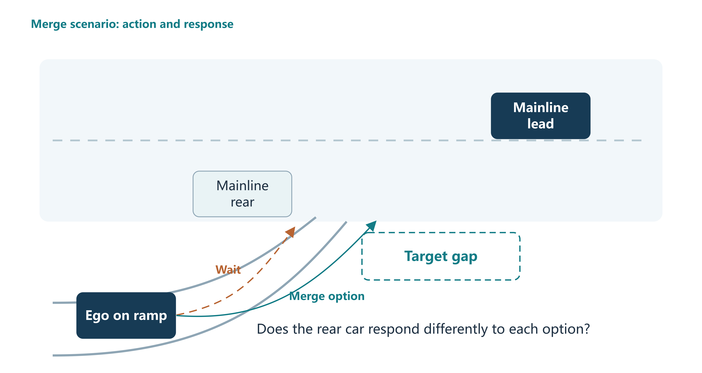
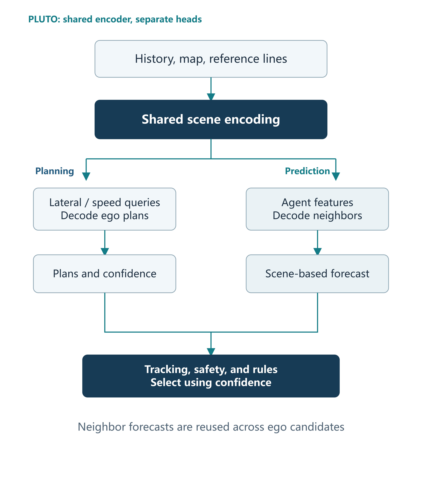
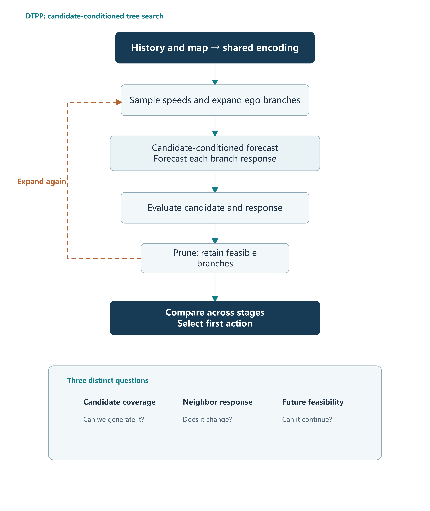

## Design trade-offs in PLUTO and DTPP

Generating several ego trajectories gives a planner options such as waiting, following, and merging at different speeds. The number of options, however, does not establish whether the system evaluates how another agent's future may change under each ego action. In an interaction-heavy scene, that dependence can change the ranking of the candidate plans.

Here *multimodal* refers to alternative motion futures or planning candidates, not different sensor modalities. A predictor can output several possible futures while reusing the same predictions for every ego candidate. Conversely, it can predict several responses separately under each specified ego candidate. These capabilities should be evaluated independently. I use the published designs of PLUTO and DTPP to compare their information dependencies, optimization paths, and error propagation. Their experiments have different settings and do not provide a controlled cross-paper ranking.

## 1. Why several candidates may still leave interaction unresolved

Consider an ego car entering a main road from an on-ramp. A mainline car approaches the target gap from behind. The planner may propose waiting, a gradual merge, and a more assertive merge. A predictor may also produce alternatives in which the rear car maintains speed or slows down. Yet, if those rear-car futures are not associated with particular ego actions, the system has not explicitly answered whether the predicted slowdown corresponds to the ego car waiting or entering the gap.

*Figure 1. Conceptual merge scenario. Arrows denote ego candidates, not observed trajectories, and do not assume that the mainline car yields.*

One design predicts neighboring agents from the observed scene and uses those predictions to score multiple ego candidates. Another feeds each ego candidate into the predictor and obtains a corresponding neighbor future. The former can represent uncertainty; the latter explicitly makes prediction depend on a proposed action. Adding modes alone does not create that dependence. The planner need not know its final action in advance: it can evaluate “what if we take this candidate?” separately for each proposal.

## 2. Three separate questions: modes, conditioning, and joint training

Let S denote history and map context, tau_i the ith ego candidate, and Y a predicted neighbor future that may itself have multiple modes. Two conceptual interfaces are:

Scene-conditioned prediction: Y = f_pred(S)

Candidate-conditioned prediction: Y_i = f_pred(S, tau_i)

These are explanatory notations, not equations quoted from either paper. The distinction is whether a specified ego future enters the prediction path, not whether the model outputs one trajectory or many. A scene-conditioned model may still learn interactions from past motion and infer ego intent; candidate conditioning explicitly states the contemplated ego action.

Multimodality answers which futures are plausible. Candidate conditioning asks how their distribution changes with an ego action. The two can coexist: there may be several ego actions and several neighbor responses under each one. Conditioning neither forces another driver to yield nor guarantees that changing a candidate always changes the prediction.

Joint training is a third property. A candidate-conditioned predictor can be paired with a hand-designed scoring rule. A shared encoder with separate prediction and planning heads can be trained together without a differentiable final cost sending gradients into the predictor. “End to end” alone does not describe these different information and optimization paths.

## 3. PLUTO: shared scene understanding, separate generation, combined selection

PLUTO jointly produces multimodal ego plans with confidence scores and forecasts for dynamic agents. Planning and prediction share scene encoding but have different output heads. For planning, lateral queries encode neighboring reference lines and longitudinal queries are learned embeddings. Factorized lateral and longitudinal self-attention, followed by scene interaction, decodes candidate plans. This directly gives a selector multiple lateral and speed choices rather than a single regressed trajectory.

The agent prediction head decodes from encoded agent features. In the version analyzed here, the paper describes a simple two-layer MLP that generates a single-modal prediction for each dynamic agent. The architectural point is not the number of prediction modes: this head does not rerun its forecast under every ego planning candidate. Adding modes to this head without supplying ego-candidate information would not change that dependency.

*Figure 2. Simplified PLUTO information flow based on its published architecture. Planning and prediction split after shared encoding and meet at proposal selection; auxiliary training paths are omitted.*

PLUTO's post-processing first retains high-confidence candidates, then uses trajectory tracking and kinematic forward simulation to evaluate progress, comfort, rule compliance, and safety. Neighbor predictions contribute to safety checks. The final choice combines rule-based outcomes with learned confidence. Prediction and planning are therefore related at the selection stage, even though their outputs are generated through separate heads.

In the merge example, waiting and entering the gap can receive different collision, progress, and comfort scores because the ego paths differ. The neighboring-agent prediction, however, is not regenerated for each path. This can still support a good decision; the interface simply does not explicitly compare how the rear car would respond to each alternative ego action.

## 4. DTPP: proposed action enters prediction and staged search

DTPP starts from a multi-stage trajectory tree. It samples target speeds along reference paths, creates dynamically feasible branches, evaluates them with conditional prediction and costs, prunes them, and expands the survivors. Dynamic programming then selects the first-stage action. A candidate is both an object to score and an input to prediction.

In DTPP, the proposed ego future enters the prediction query and the trajectory-tree context queried by attention. The same rear car can therefore receive a prediction conditioned on “ego waits” and another conditioned on “ego enters the gap.” Each candidate is evaluated together with its corresponding forecast instead of reusing one neighbor future for all proposals.

*Figure 3. Simplified DTPP inference flow based on its published design. Scene encoding is shared; conditional decoding and evaluation recur as the tree expands. The dashed return path denotes further expansion after pruning.*

DTPP's costs combine ego-motion, interaction, and collision features with scene-dependent weights. It also trains prediction and cost evaluation jointly through a differentiable path: cost-evaluation loss can backpropagate into the prediction module. Motion-prediction supervision remains present; the paper uses observed neighboring trajectories for the branch closest to the observed ego trajectory. Thus candidate conditioning changes information flow, tree search organizes multi-stage choice, and joint training changes the optimization path. None implies observed response labels for every unexecuted counterfactual branch.

## 5. The architectural trade-offs

| Dimension | PLUTO example | DTPP example |
|---|---|---|
| Forecast dependency | Scene representation; no per-candidate regeneration | Scene representation plus a specified ego candidate |
| Candidate organization | Lateral and longitudinal queries decode multiple plans | A multi-stage tree expands and prunes feasible branches |
| Proposal evaluation | Post-processing rules and learned confidence | Learned cost evaluates candidates with corresponding forecasts |
| Optimization path | Post-processing score is not a jointly differentiated cost | Cost loss can backpropagate into prediction |
| Main validation question | Is a reusable forecast sufficient for selection? | Are action-conditioned responses reliable enough for selection? |

The table compares two published designs, not a controlled head-to-head benchmark. Separate heads make forecasts, candidates, and selection logic individually inspectable, although shared encoding still couples them. Candidate-conditioned prediction makes an action-response relationship explicit, but an error in the response model can propagate directly into plan ranking. The ability to output different responses is not evidence that those responses are calibrated.

Both designs depend on candidate coverage: a selector cannot choose a useful maneuver that was never generated. Conditional decoding also adds work as branches and horizons increase. DTPP shares encoding, batches decoding, and prunes the tree; it does not rerun an entire model independently for every branch. PLUTO also pays for simulation and post-processing. Compute comparisons should therefore cover the entire decision path, not only prediction-head size.

## 6. What the reported closed-loop evidence supports

Prediction error measures trajectory fit; closed-loop scores measure repeated behavior after selected actions are executed. The papers' internal ablations illustrate why one intermediate metric should not stand in for the whole planning system.

In DTPP Table VII, Single-8s has a lower three-second forecast FDE than DTPP (0.5635 m versus 0.6830 m), yet a lower closed-loop score with reactive traffic agents (0.7558 versus 0.8978). Under configurations that both use pruning, Table II reports 0.8978 for joint training versus 0.8185 for separate training on that score. These comparisons support the value of the tested tree and training arrangements in their own settings; they cannot be combined into an isolated estimate of candidate conditioning alone.

In PLUTO Table III, adding post-processing to configuration M4 produces M5 and raises the reported aggregate score from 91.66 to 93.57, while the comfort score falls from 96.39 to 93.17. The paper relates the comfort decrease to more emergency stops triggered by safety checks. This shows that final performance depends on selection and safety processing as well as candidate generation.

A direct test of candidate conditioning should hold the scene encoder, candidate set, scoring method, training data, and compute budget as constant as possible, changing only whether forecasts receive ego-candidate information. It should report candidate ranking and closed-loop outcomes in interaction-specific slices, along with response-model errors. Numbers from these two papers should be used to interpret their own ablations, not to rank the papers against each other.

## 7. When is action dependence worth adding?

The useful decision boundary is not “highway versus city.” PLUTO itself targets dynamic urban settings. Ask instead whether neighboring-agent futures can be reused as background when comparing ego candidates, or whether their dependence on a proposed ego action changes the ranking of viable plans.

If predicted responses under alternative ego actions are similar, or differences do not change the ranking of safe candidates, reusing a forecast may be a reasonable simplification. Candidate coverage and scoring deserve attention first. If waiting, probing, and entering a gap plausibly change another driver's response enough to alter available space and the chosen maneuver, conditional prediction addresses a real information gap. Its benefit should appear in better ranking and closed-loop behavior, not merely in visibly different forecast curves.

Conditioning also creates an error path. An overly optimistic forecast that the rear car will slow down can make an assertive merge appear safer than it is. This is an engineering risk of relying on a response model, not a defect established by DTPP's experiments. A plan that is efficient if another driver cooperates must be distinguished from one that is executable *only* if that driver cooperates. The latter needs a fallback, braking room, and exit conditions when cooperation fails.

Joint optimization can align prediction and evaluation objectives, but it cannot create observed response labels for actions that were not executed. Better optimization alignment and greater behavioral fidelity are separate claims. A practical progression is to confirm candidate coverage, test whether action-conditioned prediction changes rankings beneficially, and then add multi-stage search only when the quality of the current action depends on its future continuation. Each step should be assessed for decision quality, computation, and safety under response errors.

## References

Cheng, Jie, Yingbing Chen, and Qifeng Chen. “PLUTO: Pushing the Limit of Imitation Learning-based Planning for Autonomous Driving.” arXiv, 2024. Analysis here refers to the published v1 design.

Huang, Zhiyu, et al. “DTPP: Differentiable Joint Conditional Prediction and Cost Evaluation for Tree Policy Planning in Autonomous Driving.” ICRA, 2024. Analysis here refers to the published v2 design.
