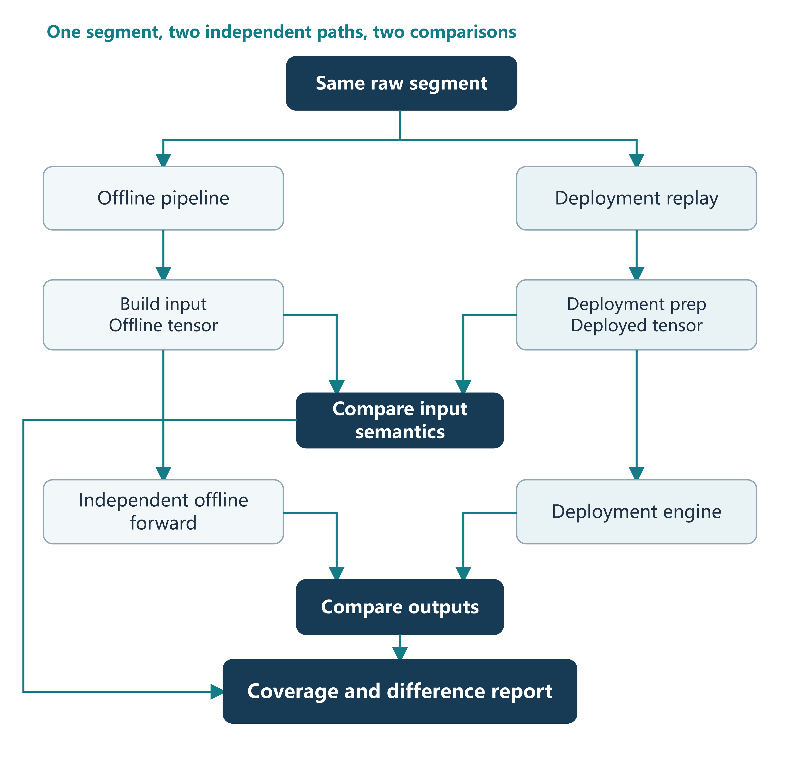
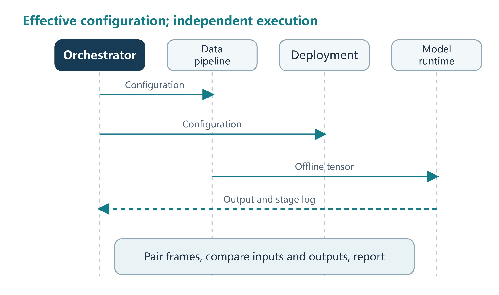
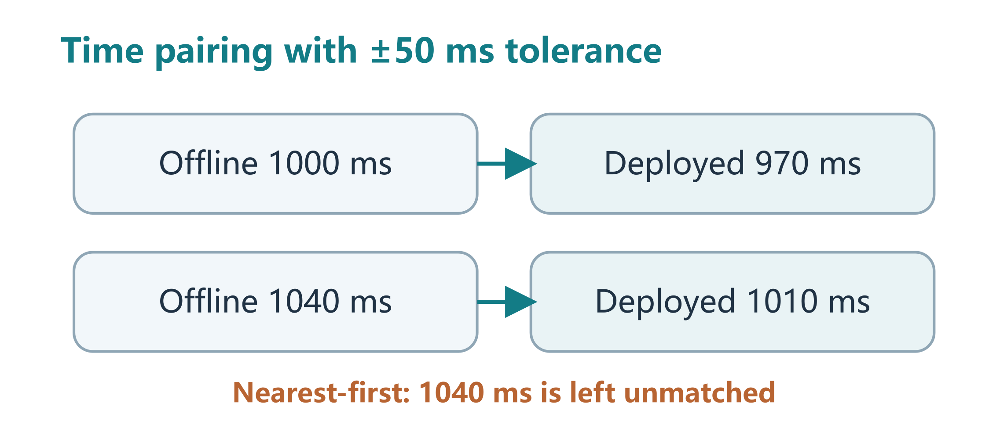
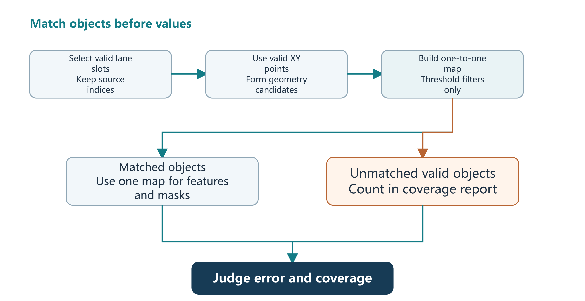
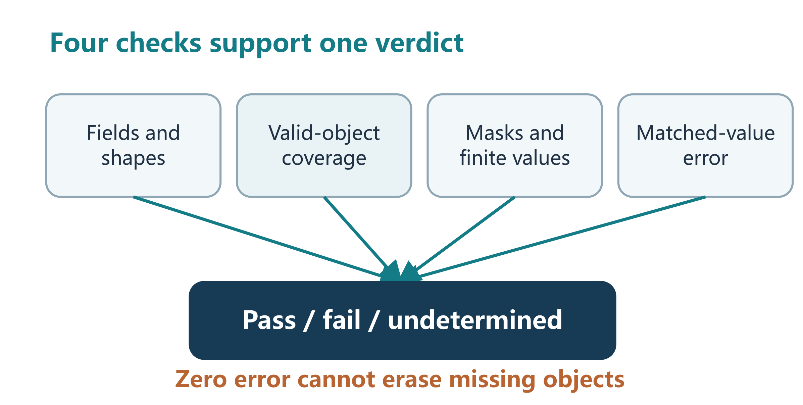
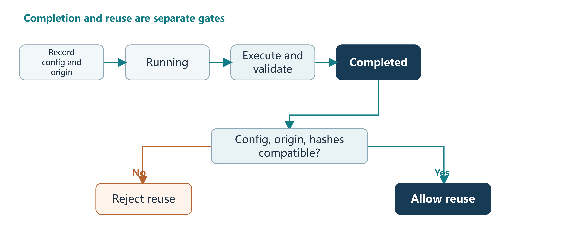

## Checking consistency between offline and deployed autonomous-driving models

When an autonomous-driving model produces different outputs offline and in deployment, investigation often starts with model conversion, the inference engine, or numerical precision. Those are legitimate suspects, but the comparison begins too late if the two systems independently perform temporal sampling, agent selection, coordinate transforms, map encoding, and tensor packaging before inference. Different semantics in any of these steps can change the input tensor and therefore the output.

Consistency validation needs an evidence chain. Are the conditions of comparison compatible? Do the two inputs represent the same scene semantics? Can an output difference be attributed to a specific stage? Matching tensor shapes and a few close numerical values cannot by themselves establish that deployment reproduces an offline conclusion. This article describes a validation protocol spanning a data pipeline, model project, and deployment project. Its central claim is that a trustworthy result requires compatible conditions, explicit coverage, numerical evidence, and traceable provenance together.

## 1. From interface equality to semantic equality

Offline and deployed systems often maintain separate preprocessing implementations. The data pipeline serves production and experiments, while deployment must meet real-time and engine constraints. Independent implementations are reasonable, but the same rule is then rewritten across languages, environments, and versions. Rewriting does not preserve semantics automatically.

Successful execution, matching tensor shape, and finite output only show that an interface can run. An **input contract** must also specify how raw records become the tensor consumed by the model.

| Contract dimension | Required definition |
|---|---|
| Time | Anchor, history window, sampling rate, and units |
| Objects | Selection, identity association, slot assignment, capacity, and truncation |
| Geometry | Coordinate frame, units, pose convention, and transform order |
| Features | Channel meanings, normalization, category encoding, and model-visible fields |
| Validity | Masks, padding, missing values, and invalid-branch semantics |

These constraints interact. Selection changes which agent occupies a slot; sampling changes the geographic extent of a map feature; masks determine which entries count as present. Even after shapes align, semantic differences may remain. The object of validation is therefore a feature with known production semantics, not an isolated array.

Before attributing a difference, classify it:

| Difference class | Typical case | Validation response |
|---|---|---|
| Representation | The same objects occupy different slots | Establish correspondence, then compare |
| Semantics | Coordinates, sampling, or validity rules differ | Find and correct the producing implementation |
| Insufficient conditions | Unknown provenance, missing fields, or no matchable frame | Limit or withhold the conclusion |

This classification sets the boundary of inference. If input semantics differ, output discrepancy cannot be assigned directly to an inference engine. If many frames or valid objects never enter the comparison, a local pass does not establish a pass for the whole segment. A report must distinguish **inconsistent** from **undetermined**.

## 2. Cross-project orchestration with independent production

The validation tool connects three roles. The data pipeline parses raw data, builds offline features, and packages model inputs. The deployment project replays preprocessing and engine inference and exports its own inputs and outputs. The model project runs an independent offline forward pass on the pipeline's packaged input to produce a reference output.

*Figure 1. The same raw segment follows two independent production paths. Input and output are compared separately, and frame-level coverage and differences are reported together.*

Input comparison checks whether the two preprocessing chains express the same scene. If inputs already differ, output evidence can still be collected, but the output discrepancy cannot be attributed solely to an engine or precision. Independent forward execution is another necessary boundary: the model project consumes the pipeline input and produces a reference through a separate execution path. Converting a deployed output into another file format changes its container, not the path that computed it.

### 2.1 Transmit an effective task configuration

The three projects may depend on different Python runtimes, dynamic libraries, and execution environments. Orchestration should make business conditions traceable without contaminating one role's environment with another's paths or variables.

Passing each business parameter as a separately assembled command-line flag creates another mapping that can omit fields, drift in defaults, or alter values through quoting. A reproducible approach passes a versioned JSON effective configuration through standard input. Receivers validate version, fields, and types; paths are absolute, sets use stable ordering, and invalid numbers are rejected. Each role may derive its execution-specific fields, but the validated business semantics must remain the same. Byte-for-byte identity of all environment-specific configuration objects is neither necessary nor desirable.

*Figure 2. One task definition and artifact interface coordinate the roles, while execution remains inside each role's environment.*

### 2.2 Stage dependencies follow the requested validation

The orchestrator must know both what a stage executes and what the current validation request consumes. An input-only check should not fail because an unrelated old model output is missing. If only one stage is rerun, unchanged historical artifacts should retain their original provenance instead of being relabeled as newly produced. Explicit dependencies, completion states, and consumption scopes make failures interpretable and reuse constrained.

## 3. Correspondence, numerical error, and completeness

### 3.1 Time pairing: report coverage together with offset

Offline and deployment sampling need not have exactly the same timestamps. First normalize units, group frames by source segment, and sort. As a configurable example, pair an offline frame with the earliest unused deployment frame inside a closed ±50 ms window. Binary search bounds the candidate window and a one-way cursor advances pairing. The result is one-to-one and reproducible. This strategy favors pairing coverage; it does not minimize the sum of time offsets globally. A real tolerance must be calibrated to sampling rate and how quickly scene content changes.

Suppose offline frames are at 1000 and 1040 ms and deployment frames are at 970 and 1010 ms. The earliest-feasible strategy pairs 1000 with 970 and 1040 with 1010. A greedy nearest-neighbor choice takes 1010 for the 1000-ms frame and leaves 1040 with no available candidate.

*Figure 3. Nearest-first pairing consumes the later frame's only candidate; earliest-feasible pairing retains two pairs.*

Pairing should also use segment identity and frame number. Duplicate identifiers, conflicting sequence numbers, or unclear origin should not be resolved by directory order. A time window only decides eligibility; it cannot prove that two frames contain the same scene. Report pairing rate, time-offset distribution, and unmatched reasons together.

### 3.2 Object correspondence: separate representation from content

After frames are aligned, slot index still does not establish physical identity. Tracked obstacles may be matched by stable identity. Lanes and road edges often require geometry: select slots with valid masks, compute a representative location from finite, nonzero XY points, and seek the nearest unused candidate in the other input while preserving original indices.

A geometry threshold such as 5 m is an example candidate filter, not proof of lane identity or numerical equality. Its value must reflect map sampling and localization error. Once a pair is formed, geometry, attributes, and masks must all use the same mapping. Unmatched valid objects remain in the completeness report even if they contribute no elementwise error.

*Figure 4. Establish object correspondence before comparing content. Matched objects share one index map; unmatched valid objects remain visible in the result.*

This method handles common slot swaps but does not guarantee globally optimal matching. Geometric proximity is not physical identity; forks, overlap, and truncation require visual inspection. Reordering is performed only on the comparison side. It does not rewrite production input and does not establish that the model is insensitive to slot order.

### 3.3 Thresholds have different jobs

| Parameter | Its job | What it cannot prove |
|---|---|---|
| Time tolerance | Determine pairable frames | That both frames contain the same scene |
| Geometric candidate threshold | Establish possible object correspondence | Object identity or feature equality |
| Numerical tolerance | Judge whether corresponding values are close | Complete fields and object coverage |

For a pair of corresponding numerical values, use

$$
|a-b| \leq \mathrm{atol} + \mathrm{rtol}\,|b|.
$$

Absolute tolerance governs near-zero values; relative tolerance scales with magnitude. Values such as $10^{-5}$ can be starting points, but tolerances need calibration to field units, quantization, and engine precision. No numerical threshold excuses missing fields or unmatched valid objects.

A useful report retains maximum and mean absolute error, RMS error, percentiles, and per-channel statistics. Maximum error exposes local anomalies; percentiles describe distributions; channel statistics separate geometry, attributes, and encoding. Each statistic describes only the part that was compared.

### 3.4 Numerical closeness does not replace completeness

The final verdict also checks field presence, shape compatibility, valid-object coverage, and non-finite values. Maximum error can be zero on matched elements while a valid lane remains unmatched; that verdict is inconsistent, not a pass. Keep the zero-error statistic so the reader can distinguish mismatched content from missing valid content. Compare masks independently: a valid slot and a valid point are different concepts. Equal shapes and valid-point counts do not substitute for checking sampling coverage or geometric content.

*Figure 5. Structural compatibility, valid coverage, validity checks, and numerical error jointly determine the verdict. Zero error on matched values cannot cancel missing valid objects.*

An auditable report states what entered the comparison, what remained outside it and why, how the compared values differ, and what level of conclusion those facts support.

## 4. Provenance, constrained reuse, and regression

### 4.1 A file's presence does not make it a trustworthy artifact

Cross-project runs are expensive, so reusing completed artifacts is useful. Reusing old inputs, weights, or files from an interrupted run without checking origin can invalidate a comparison. A readable file does not show that it belongs to this run, used this configuration, or was successfully completed.

Each stage should record its effective configuration, source identity, execution environment, completion state, and artifact fingerprint. A stage is marked running at start and completed only after successful execution and validation. File presence, stage completion, and reuse compatibility are separate conditions.

*Figure 6. A stage can be completed while a later request is incompatible with its artifacts. Reuse requires a separate compatibility check.*

Key model files and binaries can use content hashes. Large data files and directories may use metadata or tree summaries, which provide weaker assurance and must not be described as full content verification. “Read a historical result” should recover its original production context. “Reuse execution under the current request” first requires compatibility between the request and the existing artifact. Consumer defaults cannot be substituted for the parameters that produced a file. Legacy artifacts without provenance should be labeled unverified; a recorded incompatibility cannot be bypassed by an option that merely permits reading unverified artifacts.

### 4.2 Model provenance needs graded claims

Model, export, and engine files being present establishes file availability, not that they come from one export. Provenance evidence can be expressed at three levels. **Files present** means required objects are available but their relation is unproven. **Sample checked** means inspected portions match, with a conclusion limited to the sample. **Common origin verified** means export linkage records and relevant fingerprints pass. Even the strongest provenance level establishes shared origin, not numerical equivalence of two executions. Independent forward passes and output comparison are still required.

Artifact trustworthiness asks whether the objects being compared are reliable. Numerical validation asks whether reliable objects agree. Both are necessary for a complete result.

### 4.3 Turn the contract into regression checks

A one-time investigation solves a local problem; regression prevents its return. Worthwhile checks include: one correspondence map must be used for all features of a reordered object; unmatched valid objects must fail even when matched-element error is zero; absent masks must not silently become “all valid”; and a partial rerun must not consume unrelated old artifacts as if they belonged to the current run.

Validation itself has levels. Unit regression checks whether the comparison rules are implemented as specified. Real replay tests production behavior. Independent model forward versus deployment engine output tests inference agreement. A limited sample passing does not imply all scenes are equivalent, and offline-deployment agreement does not imply the model itself is correct.

The research problem is falsifiable: fix semantic contracts and provenance conditions, execute both production paths independently, then test numerical agreement and coverage together. Deliberately inject sampling shifts, slot swaps, missing masks, and stale-artifact reuse into real replays. The report should locate the induced differences and reject false passes. That is a stronger standard than subtracting two arrays once.
