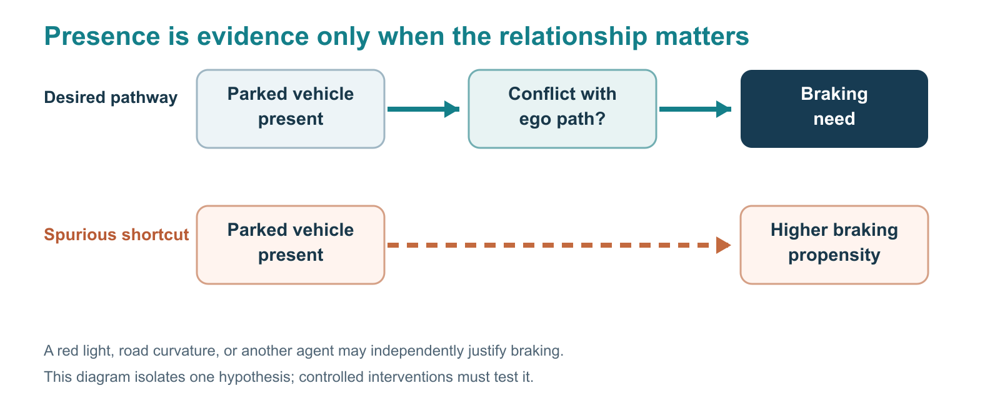

## Testing unnecessary braking around irrelevant parked vehicles with controlled interventions and safety checks

## 0. Problem statement

A learned planner may slow down unreasonably near a parked vehicle at the roadside, a behavior often called *ghost braking*. One hypothesis worth testing is that the model treats the presence of the parked vehicle as a braking cue without adequately using its relationship to the ego vehicle's path. An attention map at the moment of hard braking can suggest where to investigate. Establishing whether the vehicle actually influenced the decision requires a controlled input intervention and closed-loop validation.

When a longitudinal planning head receives only a fixed-capacity set of agents, filtering and ordering determine what information the model can access. If irrelevant parked vehicles repeatedly occupy those slots, their presence may become correlated with braking labels. This article treats that dependency as a causal-confounding hypothesis to test, rather than declaring a failure cause from one attention visualization.

I consider two layers of response. First, engineering rules reserve scarce input slots for important agents and perturb lower-relevance agents during training. Second, paired scenes, conditional losses, and closed-loop slices test whether the model distinguishes interaction risk from irrelevant background. Both layers must satisfy the same safety constraint: missed or late braking must not increase in genuine-risk scenarios.

## 1. Intended causal path and an easy shortcut

*Figure 1. The desired pathway evaluates whether a parked vehicle interacts with the ego vehicle before assigning a longitudinal braking need. The shortcut increases braking propensity from vehicle presence alone.*

Here *interaction* means the pathway by which a particular parked vehicle affects the ego vehicle's longitudinal decision; it is not the only possible cause of braking. A red light, road curvature, or another road user may also require slowing down. For a roadside parked vehicle, the relevant questions are whether it occupies the ego vehicle's driving space, creates a potential conflict, or changes feasible speed. Its mere presence does not establish a need for emergency braking.

Such shortcuts are familiar in imitation learning. De Haan and colleagues argue in *Causal Confusion in Imitation Learning* (NeurIPS 2019) that behavior cloning can exploit features correlated with expert actions even when those features are not the real cause. A related inertia problem in autonomous-driving behavior cloning, discussed by Codevilla and colleagues, links an already low speed to continued immobility. The policy may fail to move after a light turns green or a lead vehicle departs because it has learned state-action co-occurrence as though it were a decision rule.

Ghost braking could reflect a similar spurious association: parked vehicles and slowing down co-occur in the training data, and the planner learns presence instead of actual conflict. Parking areas, junctions, and slow traffic can strengthen that association. A specific incident may instead come from localization, mapping, or perception error. Those alternatives must be checked before attributing the braking to the planner.

## 2. Short-term response: an engineering rule for agent selection

A network may not immediately learn reliable causal gating. A practical short-term intervention is to change which agents it sees. Without redesigning the planning head, the system can apply a whitelist while constructing the fixed-capacity agent list and randomly mask only agents outside that whitelist during training. This imposes an inductive bias on limited representation bandwidth: interaction-relevant vehicles receive input slots first.

### 2.1 Design objectives

**Guarantee important agents.** Vehicles that are critical to interaction and longitudinal safety must enter the model and appear early in the list.

**Perturb potential shortcuts.** Irrelevant parked vehicles and other non-whitelisted agents can be dropped probabilistically during training.

**Preserve priority under truncation.** At the maximum agent count, discard lower-ranked random candidates before whitelisted agents.

This idea is related to the deletion and perturbation of noncausal agents in *CausalAgents*, although the task differs: that work studies motion-prediction robustness, whereas this proposal filters planner inputs. The whitelist is an engineering prior. Its value must be tested jointly against ghost braking, missed braking, and important-agent coverage.

### 2.2 The agent-list funnel

**Step A: prioritize the critical longitudinal lead vehicle.** Ensure that the closest in-path vehicle (CIPV), the most relevant lead vehicle in the ego lane, enters the list near the front. A relevant lead vehicle deserves a scarce slot more than an arbitrary parked vehicle elsewhere in the scene.

**Step B: classify interactions.** For each vehicle, estimate whether its projected path conflicts spatially with the ego vehicle's future path and which vehicle reaches the conflict region first:

**Ego goes first:** the swept paths conflict, and the ego vehicle is expected to pass first. **Ego yields:** the paths conflict, and the ego vehicle is expected to pass later. **No interaction:** there is no relevant conflict, or the time separation is too large.

Agents involved in either go-first or yield interactions enter the whitelist. Explicit high-risk semantics, such as a clear cut-in, can also be admitted directly so a later geometric rule does not miss them.

**Step C: apply a geometric whitelist cascade.** For agents not yet selected, apply the following priorities. A match is added to the agent list and recorded as whitelisted.

| Priority | Condition | Reason for inclusion |
| --- | --- | --- |
| 1 | Conflict interaction, whether ego goes first or yields | The relationship matters to the decision |
| 2 | Relevant vehicle ahead in the ego lane, including the CIPV | A primary longitudinal safety target |
| 3 | Crossing vehicle | May traverse the ego path |
| 4 | Relevant vehicle beside or behind the ego vehicle | May matter during a lane-change window |
| 5 | Nearby oncoming vehicle | May pose a threat from the opposite direction |
| 6 | Close neighboring vehicle | Represents immediate surrounding traffic |

Agents that match none of these conditions enter a droppable pool ordered by distance from the ego vehicle.

**Step D: mask and truncate.** During training, randomly drop only non-whitelisted agents, then truncate to capacity. Validation and deployment use deterministic filtering so the same scene does not produce different decisions because of random selection. Reports should include whitelist recall, the number of high-risk agents truncated, and changes in both unnecessary and missed braking. Random dropping aims to reduce reliance on irrelevant agents consistently occupying input slots.

### 2.3 Limits of the rule

This policy should reduce the opportunities for low-relevance parked vehicles to consume limited slots, but a lower ghost-braking rate cannot be assumed in advance. Evidence for the policy requires fewer unnecessary brakes without more missed brakes in true-interaction scenes. An improvement in average deceleration alone is insufficient to establish safety.

The model may simply stop seeing a shortcut feature rather than learn that braking depends on interaction. Rules can miss relevant agents or remove useful ones, and their thresholds may need recalibration in a new domain. The intervention is therefore a short-term engineering patch, not a substitute for causal learning. It changes the support of the input distribution, not the conditional decision mechanism itself.

## 3. Long-term response: learn when interaction warrants braking

The goal is a longitudinal planner that responds to an agent's interaction with the ego vehicle but remains stable when a verified irrelevant parked vehicle is added or removed. Four complementary interventions act on data, loss, model structure, and evaluation. Data create identifiable comparisons; losses correct gradient incentives; structure makes interaction inspectable; and evaluation keeps averages from hiding the failure mode. Without all four, a short-term reduction in braking cannot be distinguished from learning the right relationship.

### 3.1 Data and intervention: test what the model uses

Construct paired inputs that hold ego state, road, signals, and other agents as constant as possible while adding or deleting one roadside parked vehicle verified to pose no conflict. Check whether the edit changes slot order, normalization, or visibility of other agents; otherwise, the output difference may result from input reshuffling. Such a pair tests the model's sensitivity to that agent, but it does not by itself prove the causal mechanism on real roads.

If the dependency is appropriate, longitudinal outputs should remain similar before and after deletion. If the model follows the shortcut, it brakes sharply when the parked vehicle is present and stops braking when that vehicle is removed.

During training, paired perturbations can be applied to verified low-relevance parked vehicles, with a consistency constraint on longitudinal outputs. This constraint applies only when the agent truly does not change feasible driving behavior. Uncertain cases, including occlusion, a possible opening door, or a vehicle that could pull away, should retain their risk information and be evaluated separately.

In *CausalAgents* (arXiv:2207.03586, 2022), Roelofs and colleagues annotate causal agents in the Waymo Open Motion Dataset. Deleting noncausal agents produces substantial metric shifts for several prediction models; randomly dropping stationary or noncausal agents during training reduces sensitivity to such perturbations. That result motivates a robustness test here, while the planning and prediction objectives remain distinct.

### 3.2 Loss: condition longitudinal error on interaction

Training on aggregate trajectory error can hide excessive slowing near irrelevant parked vehicles. A conditional loss should first use independent labels or scene rules to establish that the target does not change a reasonable speed. It can then place extra weight on unjustified hard braking while preserving braking supervision in genuine-interaction scenes.

When the model does **not** brake sharply in a verified non-interaction case, that is the desired behavior and should not be penalized because a parked vehicle happens to be present. When it **does** brake without cause, give that error a larger coefficient so training addresses the ghost-braking failure. This coefficient belongs to the specific conditional case; it should not be merged indiscriminately with ordinary car-following errors.

A more direct term can penalize large predicted deceleration when the scene has been classified as non-interacting. The intended training signal is explicit: hard braking without interaction is an error; no hard braking without interaction is not. The condition must be reliable and should not suppress braking required by traffic signals, road geometry, or another agent.

De Haan and colleagues' analysis explains why ordinary imitation loss may reinforce features that predict action without causing it. The training objective therefore needs to distinguish *a real reason to brake* from *the incidental presence of a parked vehicle*.

### 3.3 Structure: separate object attributes from the ego relationship

If an agent's own attributes and its relationship to the ego vehicle are entangled in one representation, the model can use the easy feature *stationary* in place of a conflict assessment. An inspectable interaction representation helps diagnosis, but its presence alone does not prove that the longitudinal output depends on it.

One testable architecture estimates conflict probability, expected arrival time, and interaction type before passing relational features to the longitudinal head. A high-confidence, low-risk agent can receive less influence. Uncertain relationships and occluded agents need a conservative safety path; a hard gate could otherwise hide a real hazard.

The two feature groups should answer different questions. Object attributes such as class, dimensions, and motion-history shape describe *what kind of vehicle this is*. Relational features such as longitudinal and lateral separation, time to a potential conflict, and go-first or yield status describe *whether it interacts with the ego vehicle*.

Ablations can test whether the separation works. Remove object attributes while retaining relational features. The longitudinal output in scenes with irrelevant parked vehicles should remain approximately stable. If deleting the *stationary vehicle* attribute eliminates hard braking, the model is still relying on vehicle identity rather than the interaction relationship.

Also compare environments with many and few roadside parked vehicles. If the model brakes systematically more often only in the first environment, that is evidence of a remaining environment-specific dependency. Slice-based monitoring can precede stronger cross-environment constraints.

Rezaabad and colleagues' *Causal Imitative Model* (arXiv:2112.03908, 2021) separates inputs into latent factors and selects those relevant to the next decision. *Exploring the Causality of End-to-End Autonomous Driving* (arXiv:2407.06546, 2024) surveys common sources of causal confusion in end-to-end driving and methods such as auxiliary tasks, dropout, and interventions. These works offer design options, not direct proof that a particular ghost-braking incident has this cause.

### 3.4 Evaluation: use causal slices so averages cannot conceal failures

A lower average ghost-braking rate could reflect a planner that has become less responsive overall. Missed or late braking in true-interaction scenes may be hidden by the mean. At minimum, fix the following slices and attach them to regression gates.

| Evaluation slice | What to check |
| --- | --- |
| Verified non-interacting parked vehicles | Does ghost braking decrease? |
| Genuine interactions, including cut-ins, crossing vehicles, and critical lead vehicles | Are there more missed or late brakes? |
| Paired scenes with an irrelevant parked vehicle added or removed | Are longitudinal outputs stable? Braking only when the vehicle appears suggests a shortcut |
| Attention and attribution review | Which agents merit investigation? These views alone cannot prove causation |

Output differences in paired inputs are evidence of a dependency. If adding or removing only a low-relevance parked vehicle changes braking substantially, first check slot reshuffling and preprocessing, then analyze model reliance. Attention is a diagnostic aid. A stronger conclusion requires controlled interventions, recall on genuine interactions, and closed-loop outcomes together.

## 4. How the short-term and long-term responses connect

**Diagnose.** Rule out perception, map, and localization errors. Then test the spurious-correlation hypothesis with controlled interventions and stratified metrics.

**Contain.** Prioritize whitelisted agents and randomly mask non-whitelisted agents during training.

**Learn.** Make interaction, right-of-way status, and critical lead-vehicle status available as learnable intermediate quantities, conditional losses, and noncausal-agent dropout augmentation.

**Converge.** Gradually narrow the rules to difficult cases. The desired endpoint allows an irrelevant parked vehicle into the model without letting its presence trigger an unnecessary brake.

The rule-based patch supplies an executable definition of which interactions deserve attention. The learning program tests whether that definition can become part of the model's data, objective, structure, and evaluation. They operate on different time scales and should be judged by the same safety constraints.

## 5. Conclusion

Ghost braking may arise when a planner treats an irrelevant parked vehicle as a braking cue, but that explanation must survive counterfactual input tests and closed-loop validation. The model needs to learn the relationship between an agent and ego behavior, alongside other legitimate braking conditions such as road geometry and signals, rather than a fixed association between parked-vehicle presence and braking.

Short-term rules change which agents have access to limited input slots. Long-term training tests whether longitudinal decisions remain sensitive to genuine interactions and stable under verified irrelevant parked vehicles. The joint acceptance criterion is fewer unnecessary brakes, no loss of critical-agent coverage, and no increase in missed or late braking in real-risk scenes.

## References

[1] de Haan, Jayaraman, and Levine. "Causal Confusion in Imitation Learning." NeurIPS, 2019.

[2] Codevilla et al. Work on the inertia problem in autonomous-driving behavior cloning, in which low speed is spuriously associated with continued immobility.

[3] Roelofs et al. "CausalAgents: A Robustness Benchmark for Motion Forecasting." arXiv:2207.03586, 2022.

[4] Rezaabad et al. "Causal Imitative Model for Autonomous Driving." arXiv:2112.03908, 2021.

[5] "Exploring the Causality of End-to-End Autonomous Driving." arXiv:2407.06546, 2024.

